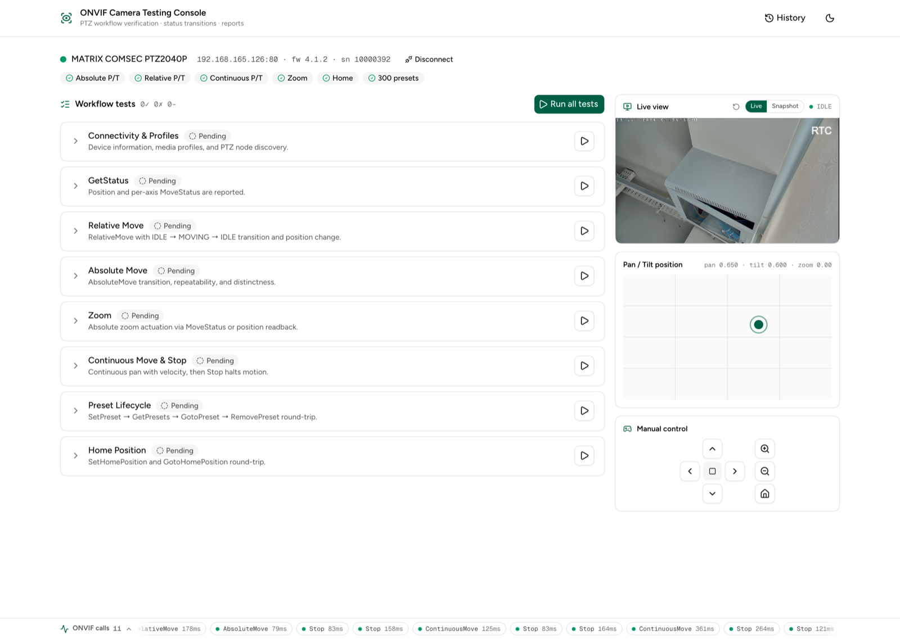
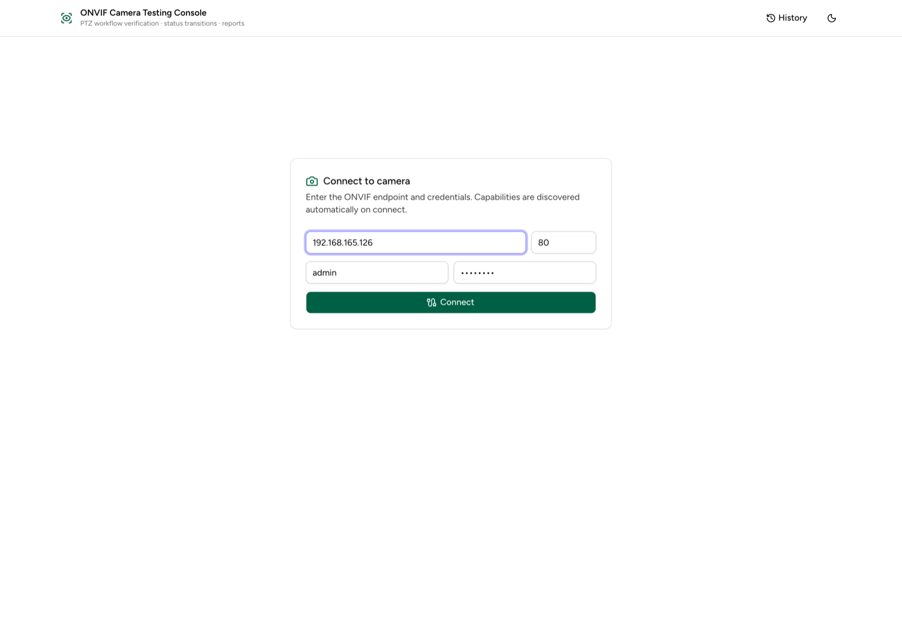
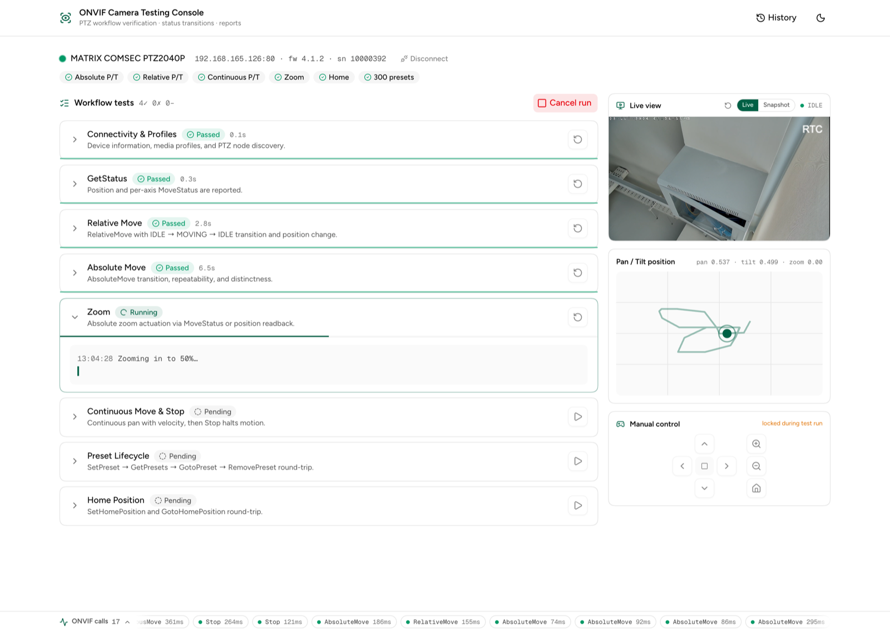
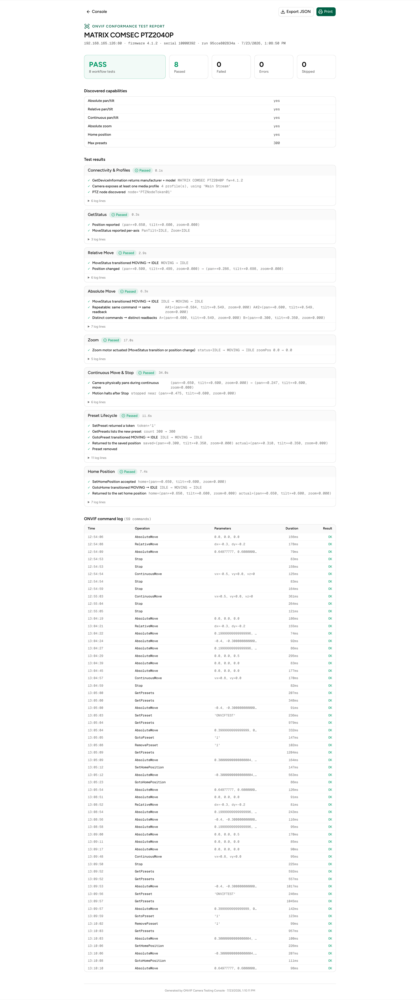
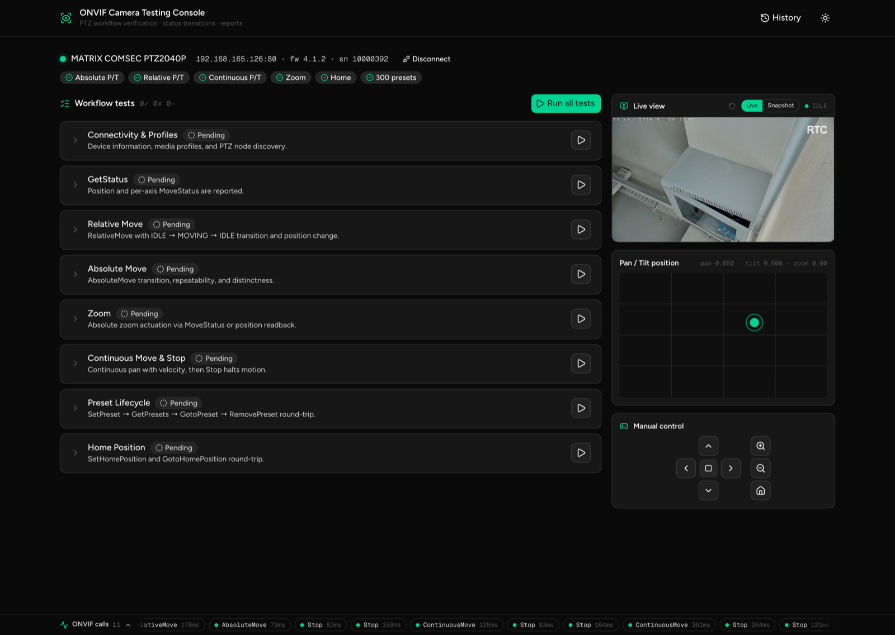

# ONVIF Camera Testing Console

A vendor-neutral testing suite for **any ONVIF-compliant PTZ camera**, with an
agentic web console: connect to a camera, watch every workflow test run live
(streaming logs, progress, MoveStatus transitions), drive the camera manually,
and export a printable conformance report.



| Component | Description |
|--|--|
| **UI** | Next.js (static export) styled with the [careui](https://careui.ohc.network) design system |
| **Sidecar** | FastAPI (Python) — wraps the ONVIF client, streams events over SSE, serves the built UI |
| **Tests** | Vendor-neutral PTZ workflow tests, also available as a plain pytest suite |
| **Live view** | WebRTC via [go2rtc](https://github.com/AlexxIT/go2rtc) when available, ONVIF snapshot polling otherwise |

> Why a sidecar? Browsers cannot speak ONVIF (SOAP + WS-Security digest, no
> CORS on cameras). The static UI talks to the small local API server, which
> issues the actual ONVIF calls and relays camera video.

## Features

- **Connect panel** — enter IP/credentials; device info, profiles, and PTZ
  capabilities are discovered automatically on connect
- **8 workflow tests** — connectivity, GetStatus, relative / absolute / zoom /
  continuous moves, preset lifecycle, home position. Each shows live progress,
  streaming logs, per-check pass/fail, and errors. Re-run any test
  individually or run everything at once
- **MoveStatus transition verification** — every positioning move is polled
  for the `IDLE → MOVING → IDLE` sequence
- **Live view** — real-time WebRTC video (go2rtc) with an ONVIF-snapshot
  mode as a switchable alternative; defaults to live when available
- **Pan/Tilt visualizer** — real-time position map with motion trail
- **Manual control** — press-and-hold joystick, zoom, home (locked during runs)
- **ONVIF call ticker** — every command issued to the camera, with timing and
  result, expandable into a full log
- **Report page** — PASS/FAIL verdict, capability matrix, per-test checks,
  full command log; print-optimized (browser print → PDF) and JSON export
- **Run history** — past runs stored per camera in the browser (localStorage)

## Screenshots

**Connect** — enter the camera endpoint and credentials; device info and PTZ
capabilities are discovered automatically on connect.



**Running tests** — each test streams progress, logs, and per-check pass/fail
in real time. The live camera feed, pan/tilt position visualizer, and ONVIF
call ticker update alongside so you can see exactly what's happening on the
camera.



**Report** — PASS/FAIL verdict, discovered-capability matrix, per-test checks,
and the full ONVIF command log. Print to PDF or export JSON.



**Dark mode** — the whole console (careui design system) adapts to light/dark.



## Set up with an AI agent

Copy this prompt into any AI coding agent (Claude Code, Cursor, Copilot, …)
running on the machine that will host the console:

```text
Set up and run the ONVIF Camera Testing Console from
https://github.com/ohcnetwork/onvif-console (or the local checkout if it already
exists).

Requirements: Python 3.11+, Node 20+ with pnpm. The machine must be on the
same network as the ONVIF camera(s) to test.

Steps:
1. Clone the repo (skip if already present) and cd into it.
2. Backend: `python3 -m venv backend/.venv` then
   `backend/.venv/bin/pip install -r backend/requirements.txt`
3. UI: `pnpm install` then `pnpm build` (produces ./out, served by the backend).
4. Optional but recommended — live WebRTC video: install the go2rtc binary
   for this OS/arch from https://github.com/AlexxIT/go2rtc/releases/latest
   (asset names look like go2rtc_mac_arm64.zip, go2rtc_linux_amd64, …),
   unzip if needed, and place the executable at backend/bin/go2rtc
   (chmod +x). Verify with `backend/bin/go2rtc --version`. Without it the
   console falls back to ~1 fps snapshot polling.
5. Start: `./start.sh` (or `cd backend && .venv/bin/uvicorn server:app
   --host 0.0.0.0 --port 5800`).
6. Verify: `curl -s -o /dev/null -w "%{http_code}" localhost:5800/` prints
   200, and GET localhost:5800/api/session returns 404 (no camera connected
   yet — that's expected).
7. Tell me to open http://<this-machine's-ip>:5800, enter the camera IP and
   credentials in the UI, and press Connect.

Prefer Docker instead? `docker compose up -d --build` replaces steps 2–6
(includes go2rtc). If the console will be opened from OTHER devices, set
GO2RTC_PUBLIC_URL=http://<this-machine's-ip>:1984 when composing up, so the
live-video embed points at a reachable address.

Do not expose port 5800 to the public internet — the console has no
authentication and relays camera credentials.
```

## Quick start (manual)

Prereqs: Python 3.11+, Node 20+ with pnpm (only needed to build the UI).

```bash
./start.sh          # first run: creates venv, builds UI, then serves
# → http://localhost:5800
```

Or step by step:

```bash
# 1. backend
python3 -m venv backend/.venv
backend/.venv/bin/pip install -r backend/requirements.txt

# 2. UI (rebuild after changing src/)
pnpm install
pnpm build          # emits ./out, served by the sidecar

# 3. serve UI + API
cd backend && .venv/bin/uvicorn server:app --host 0.0.0.0 --port 5800
```

### UI development

```bash
pnpm dev            # Next.js dev server on :3000, proxying API to :5800
pnpm serve          # the sidecar (in another terminal)
```

### Live video (WebRTC)

The sidecar looks for a `go2rtc` binary on `PATH` **or at
`backend/bin/go2rtc`** (or an instance already listening on `:1984`, e.g. the
docker-compose service). When found, it wires the camera's RTSP stream into
go2rtc on connect and the console shows real-time WebRTC video, with a
Live / Snapshot switch in the panel (preference remembered). Without go2rtc,
the console automatically uses ONVIF snapshot polling.

To install: grab the binary for your OS/arch from
[go2rtc releases](https://github.com/AlexxIT/go2rtc/releases/latest) and place
it at `backend/bin/go2rtc` (`chmod +x`).

Env overrides: `GO2RTC_API` (default `http://127.0.0.1:1984`) and
`GO2RTC_PUBLIC_URL` (browser-facing embed URL, when they differ).

Implementation notes for oddball cameras (already handled automatically):

- Some cameras emit an H.264 keyframe **only at RTSP session start**. The UI
  therefore "kicks" the go2rtc producer (fresh RTSP session) every time the
  live player mounts, and the panel has a manual restart button
  (`POST /api/stream/kick`) for stubborn cases.
- On multi-interface hosts (VPNs etc.) the spawned go2rtc is configured with
  an explicit `127.0.0.1` ICE candidate, otherwise local WebRTC can fail.

## Deployment

The console must run on a machine that can reach the camera's network — a LAN
server, a Raspberry Pi, or your laptop.

**Docker (recommended):**

```bash
docker compose up -d --build
# → http://<server-ip>:5800   (go2rtc WebRTC relay included)
# opening the console from another device? set the browser-facing embed URL:
GO2RTC_PUBLIC_URL=http://<server-ip>:1984 docker compose up -d --build
```

**Bare metal:** run `./start.sh` under systemd / a process manager.

The UI is fully static (`out/`) and the sidecar serves it — a single port
(5800) is all you need to expose. Don't expose it to the public internet
as-is: the console has no authentication of its own and relays camera
credentials you type into it.

## pytest suite (headless)

The same vendor-neutral tests exist as a plain pytest suite for CI/scripted
use, configured via env vars (or a `.env` at the repo root):

```bash
cp .env.example .env      # ONVIF_HOST / ONVIF_PORT / ONVIF_USER / ONVIF_PASS
cd backend
.venv/bin/python -m pytest tests/ -v      # unit tests
.venv/bin/python run_tests.py             # exploratory run with readable output
.venv/bin/python probe.py                 # one-shot capability probe
```

## Project layout

```
├── src/                  # Next.js UI (careui design system)
│   ├── app/              # console (/), report (/report), history (/history)
│   ├── components/       # console panels, report view, ui primitives
│   └── lib/              # api client, SSE store, types, run history
├── backend/
│   ├── onvif_ptz.py      # vendor-neutral ONVIF PTZ client (capability discovery)
│   ├── engine.py         # test registry + event bus + instrumented client
│   ├── server.py         # FastAPI: REST + SSE + snapshot proxy + go2rtc + static UI
│   ├── tests/            # pytest suite
│   ├── run_tests.py      # exploratory CLI runner
│   └── probe.py          # capability probe
├── scripts/screenshots.mjs  # regenerates docs/screenshots (pnpm screenshots)
├── Dockerfile            # UI build + Python runtime in one image
├── docker-compose.yml    # console + go2rtc relay
└── start.sh              # one-command local start
```

Screenshots in this README are generated by `pnpm screenshots` (drives a local
Chrome against a running, connected console).

## How the tests stay vendor-neutral

- **Capabilities are discovered, not assumed** — unsupported workflows are
  skipped, not failed. A fixed (non-PTZ) camera runs only the applicable checks.
- **Move targets derive from the camera's advertised coordinate ranges**, not
  hardcoded values.
- **Absolute positioning is validated by repeatability + distinctness** (same
  command → same readback, different commands → different readbacks) — cameras
  are free to report position in a different space than they accept commands.
- **Zoom / continuous moves validate adaptively** — via `MoveStatus` when the
  camera reports it for that move type, otherwise via observed motion
  (`MoveStatus` tracking for continuous moves is optional in ONVIF).
- **A short settle before position reads** absorbs encoder-readback lag some
  cameras show right after `MoveStatus` flips to `IDLE`.
